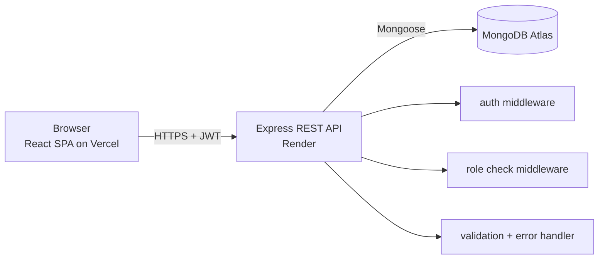

<div align="center">

# 📚 BookVerse - Bookstore Management System

**A full-stack MERN application with JWT authentication, role-based access control, inventory management and transactional order processing.**

[](https://bookstore-management-system-peach.vercel.app/)
[](https://bookstore-management-system-dn5s.onrender.com/api/docs)


[Live Demo](https://bookstore-management-system-peach.vercel.app/) · [API Docs](https://bookstore-management-system-dn5s.onrender.com/api/docs) · [Backend API](https://bookstore-management-system-dn5s.onrender.com)

</div>

> **Note:** The backend runs on a free hosting tier and sleeps after inactivity. The first request can take 30-60 seconds to wake it up.

---

## Table of Contents

1. [Overview](#overview)
2. [Features](#features)
3. [Tech Stack](#tech-stack)
4. [Architecture](#architecture)
5. [Screenshots](#screenshots)
6. [Getting Started](#getting-started)
7. [Environment Variables](#environment-variables)
8. [API Reference](#api-reference)
9. [Data Models](#data-models)
10. [Security](#security)
11. [Testing](#testing)
12. [Deployment](#deployment)
13. [Project Structure](#project-structure)
14. [Roadmap](#roadmap)
15. [Author](#author)

---

## Overview

BookVerse is a bookstore platform with two roles:

- **Customers** browse and search books, build a cart, place orders and track or cancel them.
- **Admins** manage the book catalogue (add, edit, delete), monitor all orders and update order and payment status.

The backend is a documented REST API (Swagger/OpenAPI) with request validation, centralized error handling and an automated test suite. The frontend is a responsive React single-page application.

## Features

### Customer
- Register and log in with JWT-based authentication
- Browse books with **search, genre filter and pagination**
- Book detail page with stock availability
- Persistent **shopping cart** (survives page refresh)
- Checkout and order history
- Cancel pending orders (stock is restored automatically)

### Admin
- Add, edit and delete books (with confirmation dialogs)
- View all orders and filter by status
- Update order status (`pending`, `processing`, `shipped`, `delivered`, `cancelled`) and payment status (`unpaid`, `paid`, `refunded`)

### Engineering
- **Role-based access control** enforced on the server and mirrored on the client (protected and admin-only routes)
- **Transactional order creation** with atomic stock decrement, which prevents overselling
- Request validation with `express-validator` and consistent error responses
- Admin accounts created through a seed script, never through public registration
- Separate test database so tests never touch real data
- Interactive API documentation with Swagger UI

## Tech Stack

| Layer | Technologies |
|-------|--------------|
| **Frontend** | React 18, Vite, React Router, Axios (JWT interceptor), Context API, React-Toastify, Bootstrap 5 |
| **Backend** | Node.js, Express, Mongoose, JSON Web Tokens, bcryptjs, express-validator, CORS |
| **Database** | MongoDB Atlas |
| **Testing** | Jest, Supertest |
| **API Docs** | Swagger UI (OpenAPI 3), Postman/Thunder Client collection |
| **Deployment** | Vercel (frontend), Render (backend), MongoDB Atlas (database) |

## Architecture



**Request flow:** React → Axios (attaches `Authorization: Bearer <token>`) → `protect` middleware (verifies JWT) → `authorize` middleware (checks role) → validator → controller → Mongoose → MongoDB.

## Screenshots

> Add your screenshots to a `docs/screenshots/` folder and update the paths below.

| Home | Book list | Cart |
|------|-----------|------|
|  |  |  |

| My Orders | Admin - Books | Admin - Orders |
|-----------|---------------|----------------|
|  |  |  |

## Getting Started

### Prerequisites
- Node.js 18 or later
- A MongoDB Atlas cluster (free M0 tier is enough)
- Git

### 1. Clone the repository
```bash
git clone https://github.com/Khushi288-creator/bookstore-management-system.git
cd bookstore-management-system
```

### 2. Run the backend
```bash
cd backend
npm install
cp .env.example .env      # Windows: copy .env.example .env
# edit .env and fill in MONGO_URI and JWT_SECRET
npm run dev               # http://localhost:5000
```

Generate a strong JWT secret:
```bash
node -e "console.log(require('crypto').randomBytes(32).toString('hex'))"
```

### 3. Create an admin user
Public registration always creates a **customer**. Create an admin with the seed script:
```bash
npm run create-admin -- admin@example.com <your-password> Admin
```

### 4. Run the frontend
```bash
cd ../frontend
npm install
cp .env.example .env      # Windows: copy .env.example .env
npm run dev               # http://localhost:5173
```

## Environment Variables

### `backend/.env`

| Variable | Description |
|----------|-------------|
| `PORT` | Server port (default `5000`) |
| `MONGO_URI` | MongoDB Atlas connection string, including the database name |
| `JWT_SECRET` | Secret used to sign tokens |
| `JWT_EXPIRES_IN` | Token lifetime, e.g. `7d` |
| `MONGO_URI_TEST` | *(optional)* Connection string for the test database |

### `frontend/.env`

| Variable | Description |
|----------|-------------|
| `VITE_API_URL` | Base URL of the backend API, without a trailing slash |

> `.env` files are git-ignored. Never commit secrets.

## API Reference

Interactive documentation: **[/api/docs](https://bookstore-management-system-dn5s.onrender.com/api/docs)**
Postman / Thunder Client collection: [`docs/bookstore-api.postman_collection.json`](docs/bookstore-api.postman_collection.json)

### Auth

| Method | Endpoint | Access | Description |
|--------|----------|--------|-------------|
| POST | `/api/register` | Public | Register a customer (role is always `customer`) |
| POST | `/api/login` | Public | Log in and receive a JWT |
| GET | `/api/auth/me` | Authenticated | Current user profile |

### Books

| Method | Endpoint | Access | Description |
|--------|----------|--------|-------------|
| GET | `/api/books` | Public | List books. Query: `page`, `limit`, `search`, `genre` |
| GET | `/api/books/:id` | Public | Single book |
| POST | `/api/books` | Admin | Create a book |
| PUT | `/api/books/:id` | Admin | Update a book |
| DELETE | `/api/books/:id` | Admin | Delete a book |

### Orders

| Method | Endpoint | Access | Description |
|--------|----------|--------|-------------|
| POST | `/api/orders` | Authenticated | Place an order (validates and decrements stock) |
| GET | `/api/orders/my` | Authenticated | Own orders |
| GET | `/api/orders` | Admin | All orders. Query: `page`, `limit`, `status` |
| GET | `/api/orders/:id` | Owner or admin | Single order |
| PUT | `/api/orders/:id/cancel` | Owner or admin | Cancel an order and restore stock |
| PUT | `/api/orders/:id/status` | Admin | Update order and payment status |

**Example: login**
```http
POST /api/login
Content-Type: application/json

{ "email": "user@example.com", "password": "yourPassword" }
```
```json
{
  "success": true,
  "message": "Login successful",
  "token": "<jwt>",
  "user": { "id": "...", "name": "...", "email": "...", "role": "customer" }
}
```

Protected endpoints require the header `Authorization: Bearer <token>`.

## Data Models

| Model | Key fields |
|-------|-----------|
| **User** | `name`, `email` (unique), `password` (bcrypt hash, never returned), `role` (`customer` or `admin`) |
| **Book** | `title`, `author`, `genre`, `price`, `stock`, `isbn` (unique), `description`, `imageUrl` |
| **Order** | `user` (ref), `items[]` (`book` ref, `quantity`, `price` snapshot), `totalPrice`, `status`, `paymentStatus` |

The item `price` is stored at the time of purchase, so later price changes do not alter past orders.

## Security

- Passwords hashed with **bcrypt** (salted); the password field is excluded from queries by default
- **JWT** authentication with expiry; invalid or expired tokens are rejected with `401`
- **Role-based authorization** returns `403` for insufficient permissions
- Admin role cannot be obtained through public registration
- Input validation on auth, book and order endpoints
- Secrets are kept in environment variables and excluded from version control
- Order placement uses a database transaction and an atomic stock check to avoid overselling

## Testing

Backend tests use **Jest + Supertest** against a **separate database** (`bookstore_test`), so your real data is never modified.

```bash
cd backend
npm test
```

| Suite | Covers |
|-------|--------|
| Auth | Register, login, admin-role escalation blocked, `/auth/me` |
| Books | Public listing, admin create/delete, customer blocked (403), no token (401) |
| Orders | Create order and stock decrease, my orders, admin list, cross-user access blocked, cancel and stock restore, status update |

**14 tests passing.**

## Deployment

| Service | Platform | Configuration |
|---------|----------|---------------|
| Frontend | Vercel | Root `frontend`, build `npm run build`, output `dist`, env `VITE_API_URL` |
| Backend | Render | Root `backend`, build `npm install`, start `npm start`, env vars from the table above |
| Database | MongoDB Atlas | Network access configured for the hosted backend |

`frontend/vercel.json` rewrites all routes to `index.html` so client-side routing works on refresh.

## Project Structure

```
bookstore-management-system/
├── backend/
│   ├── app.js                 # Express app (shared by server and tests)
│   ├── server.js              # HTTP server entry point
│   ├── config/                # DB connection, Swagger setup
│   ├── controllers/           # auth, book, order logic
│   ├── middleware/            # auth (JWT), roleCheck, validation, errorHandler
│   ├── models/                # User, Book, Order
│   ├── routes/                # Route definitions
│   ├── validators/            # express-validator rules
│   ├── scripts/               # createAdmin.js
│   └── tests/                 # Jest + Supertest suites
├── frontend/
│   └── src/
│       ├── api.js             # Axios instance + interceptors
│       ├── context/           # AuthContext, CartContext
│       ├── components/        # Navbar, BookCard, route guards, ...
│       └── pages/             # Home, Books, BookDetail, Cart, Checkout, MyOrders, admin/*
└── docs/                      # API collection, screenshots
```

## Roadmap

- [x] REST API: auth, books, orders, validation
- [x] Swagger documentation and API collection
- [x] Backend test suite
- [x] React frontend (customer and admin)
- [x] Deployment (Vercel + Render + Atlas)
- [ ] Frontend tests (React Testing Library)
- [ ] Faster backend tests with an in-memory MongoDB
- [ ] Payment gateway integration (Stripe/Razorpay)
- [ ] Book reviews and ratings
- [ ] Image upload for book covers
- [ ] CI pipeline (GitHub Actions) running tests on every push

## Author

**Khushi**
GitHub: [@Khushi288-creator](https://github.com/Khushi288-creator)

Built as part of an internship project on REST API development with the MERN stack.

## Live Links (after deployment)

- Backend: _TBD_
- Frontend: _TBD_
